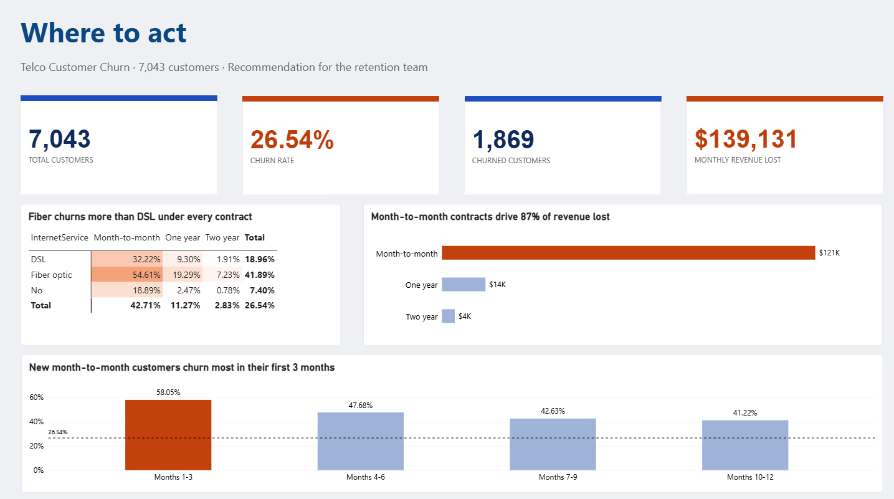
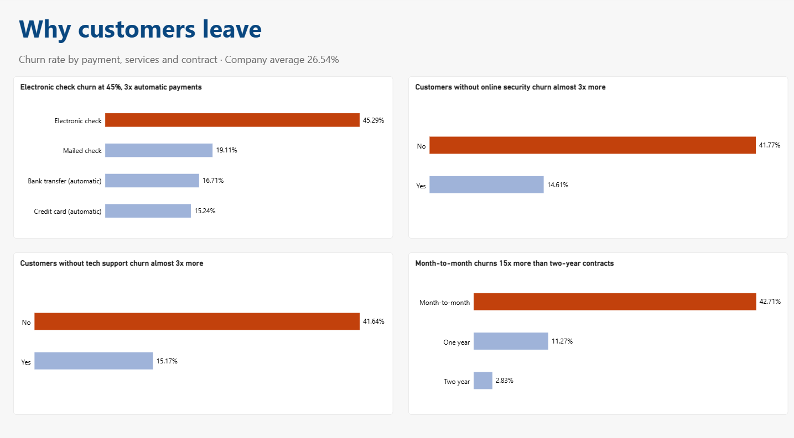

# Telco Customer Churn Analysis
## Overview
Churn analysis of a fictional telecommunications company (synthetic Kaggle dataset, 7,043 customers), framed as if advising the Head of Customer Retention. Just over 1 in 4 customers churned (26.5%), representing about $139K in lost monthly revenue. With a limited retention budget, the question was where to focus it.

**Recommendation:** target new fiber customers on month-to-month contracts during their first three months, offering an annual contract, protection services and automatic payment. This segment churns at 55% and accounts for 72% of lost revenue.

---

## Author
**Belén Micó Velarde**  
[LinkedIn](https://www.linkedin.com/in/belenmicovelarde)

---

## Tools
- **MySQL** --> data exploration, cleaning, and analysis
- **Power BI** --> interactive dashboard and DAX measures

---

## Business Problem

- **Client:** Head of Customer Retention, who owns the retention budget.
- **Pain:** they can see customers leaving every month, but not which customers are most at risk or why. Retention works blind: everyone is treated the same, or action comes only when a customer calls to cancel. Budget goes to customers who would have stayed anyway, while those at real risk are missed.
- **Decision:** which customer segments and which levers to focus retention on, with a limited budget that cannot cover every customer.

---

## Business Questions & Metrics

1. Which types of customers churn the most?
2. Do customers with certain services churn less than those without?
3. Do contract and payment conditions affect churn?
4. Do customers who pay more churn more?
5. How many customers and how much monthly revenue are lost per segment?

| Role | Metric | Why |
|---|---|---|
| Primary | Churn rate (%) | Measures risk and allows comparing both segments and levers |
| Supporting | Monthly revenue lost | Covers what the rate misses: group size and how much each customer pays |
| Diagnostic | Churn rate by service, contract and payment method | Explains why a segment churns more |

---

## Key Findings

1. **Month-to-month contracts drive churn.** They churn at 42.7% (vs 2.8% for two-year contracts) and account for 89% of all churners.
2. **Fiber + month-to-month is the most critical segment.** 54.6% churn and 72% of lost revenue, with $47 at risk per customer (vs $32-36 in other segments). Fiber churns more than DSL under every contract type, so the problem is not explained by the contract alone.
3. **The first months are the riskiest.** New month-to-month customers churn at 51%, and more than half of them leave within the first three months. Within the same contract, new customers churn 18 points more than long-standing ones.
4. **Protection services go with lower churn.** Customers without online security or tech support churn at about 42% vs about 15% with them. The gap holds among month-to-month customers (20 points for tech support), where most churn happens.
5. **Electronic check customers churn at 45%,** vs 15-17% for automatic payment methods.
6. **Price alone does not explain churn.** Within the same internet service, churners pay the same or less than customers who stay.

*Also checked:* gender, streaming, phone services and paperless billing show no meaningful or actionable difference.

---

## Recommendation

Focus the retention budget on new fiber customers on month-to-month contracts during their first three months, offering an annual contract, protection services and automatic payment.

**Who**, in order of priority depending on budget:

| Priority | Segment | Customers | Churn rate | Share of churners |
|---|---|---|---|---|
| 1 | Full risk profile: new, month-to-month, fiber, no online security, no tech support, electronic check | 544 | 74% | 22% |
| 2 | Fiber + month-to-month | 2,128 | 55% | 62% |
| 3 | First year + month-to-month | 1,994 | 51% | 55% |

Each level reaches more churners but with a lower rate, so the budget starts at the top. Priority 1 gets the most intensive action (personal contact, best offer); the others get a standard program.

**When:** from day one and during the first three months, when more than half of new customers leave.

**What to offer:**
- An annual contract, so the customer is committed.
- Free online security and tech support for a trial period, to increase perceived value.
- An incentive to switch to automatic payment, so the decision is not reconsidered every month.

**How to measure it:** run the offer on part of the segment and keep a control group without it, then compare churn after one quarter before rolling it out further.

**What not to do:** general discounts (price alone does not explain churn), removing electronic check (forcing 2,365 customers to switch could trigger churn), or going back to paper billing (not a likely cause and adds cost).

---

## Approach

- **Data cleaning.** The first churn rate came out at 0%, which contradicted the 1,869 churners seen during profiling. The cause was a hidden Windows character (`\r`) added to every Churn value during the CSV import. I also set 11 blank `TotalCharges` values to 0: they matched the 11 customers with zero tenure, who had not been billed yet.
- **Checking each finding.** Several drivers overlap, so I crossed them with the contract type to see whether they still mattered on their own. I also checked that the combined risk profile actually exists (544 customers, 74% churn).
- **Prioritising by money.** With a limited budget, I compared segments by revenue at risk per customer contacted, not only by churn rate.

The full analysis, with every query commented with what it checks and what it found, is in [`telco_customer_churn_analysis.sql`](telco_customer_churn_analysis.sql).

---

## Dashboard

Built in Power BI, connected directly to the cleaned MySQL table, so the dashboard and the SQL analysis use the same data.

**Where to Act**: size of the problem, the riskiest segment, where revenue is lost and when to act.



**Why Customers Leave**: churn rate by payment method, protection services and contract.



**DAX measures**

```
Total Customers   = COUNTROWS(telco_customer)
Churned Customers = CALCULATE(COUNTROWS(telco_customer), telco_customer[Churn] = "Yes")
Churn Rate        = DIVIDE([Churned Customers], [Total Customers])
Revenue Lost      = CALCULATE(SUM(telco_customer[MonthlyCharges]), telco_customer[Churn] = "Yes")
```

---

## Limitations

- **Correlation, not causation.** The data shows what goes with churn, not what causes it. Crossing variables rules out some explanations, which is why the recommendation includes a control group.
- **A single snapshot.** There is no time dimension, so it is not possible to tell whether these patterns are stable, seasonal or changing.
- **No satisfaction or service quality data.** It is not possible to confirm why fiber churns more: price, technical issues or support.
- **No competitor or promotion data.** It is unknown whether customers leave for cheaper offers, or whether new customers joined through temporary promotions.
- **No cost data for retention actions.** Return on the retention program, and how far down the priority list it pays off, cannot be calculated.
- **Simplified revenue estimate.** Lost revenue is based on monthly charges; the annual figure assumes churned customers would have stayed one more year.
- **Full churn only.** Customers who drop services without leaving (downgrades) are not captured.
- **Synthetic dataset.** Patterns may not reflect a real telecom company.

---

## Dataset, Tools & Repository

- **Source:** [Telco Customer Churn](https://www.kaggle.com/datasets/blastchar/telco-customer-churn) (Kaggle)
- **Volume:** 7,043 customers · 21 columns (demographics, tenure, services, contract and billing, churn)
- **Tools:** MySQL (profiling, cleaning and analysis) · Power BI and DAX (dashboard)

```
telco-customer-churn/
│
├── README.md
├── telco_customer_churn_analysis.sql
├── telco_customer_churn_dashboard.pbix
├── dashboard_page1.png
└── dashboard_page2.png
```

*This project uses a synthetic dataset for portfolio purposes. There was no real client: the analysis was framed around a Head of Customer Retention to give it a concrete business decision.*
